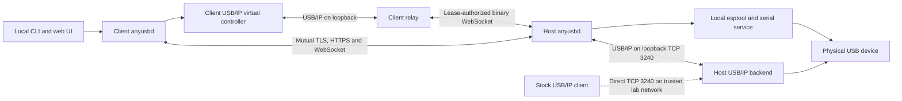

# AnyUSB architecture

**Phase 1 design.** The [M0 report](test-report/m0.md) records the evidence and
open hardware checks. The builds carry the Linux and Windows backends, peer
control plane, Remote ESP operations, local web UI and CLI.

## Components and interfaces

Each Windows or Linux machine can act as a USB host, a USB client, or both.
`anyusbd` is a Go service managed by systemd or the Windows Service Control
Manager. `anyusb` and the loopback web UI use its local API. Device drivers such
as CP210x, CH340, CDC ACM, and the Windows JTAG interface driver bind on the
importing computer during USB passthrough. Remote ESP operations use the drivers
and physical port on the exporting computer. [USB/IP protocol](https://docs.kernel.org/usb/usbip_protocol.html)

| Platform | Exports local devices | Imports remote devices | Inventory and events |
| --- | --- | --- | --- |
| Linux | `usbip-host`, `usbipd`, `usbip bind` and `usbip unbind` | `vhci_hcd`, `usbip list --remote`, `usbip attach`, `usbip port`, `usbip detach` | sysfs topology, udev notifications and inventory reconciliation |
| Windows | `usbipd-win` service, `usbipd bind`, `usbipd unbind` | `usbip-win2` UDE, `usbip.exe list`, `attach`, `port`, `detach` | `usbipd state` JSON, PnP location paths and device notifications |

The agent polls Linux sysfs or Windows PnP for inventory changes. The native
local API uses a root-only Unix socket or administrator-only named pipe. It serves device and import
snapshots, share and unshare, connect and disconnect, diagnostics, and a
newline-delimited JSON event stream. Mutations are serialized across callers.
The native `usbipd` remains a separate service. The M1 agent neither starts it
nor changes firewall rules. The loopback UI exposes the same operations through
an ephemeral bearer token and same-origin checks.

The adapter exposes `ListLocalDevices`, `Export`, `Unexport`, `ListRemote`,
`Attach`, `Detach`, and `WatchHotplug`. Use typed state for inventory, errors,
session identifiers, and export readiness. Prefer structured backend state such
as `usbipd state` or sysfs when available. Wrap commands using explicit executable
paths and argument arrays. Preserve exit code and stderr for diagnostics and
normalize known errors such as absent, busy, permission denied, and unsupported.
Enumerate imported devices separately to prevent exporting them again. On Windows,
use the virtual port reported by the import backend to find the corresponding PnP
device and its interface handles. [Linux tooling](https://github.com/torvalds/linux/blob/master/tools/usb/usbip/README), [Windows host automation](https://github.com/dorssel/usbipd-win/wiki/Automation), [Windows client CLI](https://github.com/vadimgrn/usbip-win2/blob/v.0.9.8.1/userspace/usbip/usbip.cpp)

## Control plane and leases

LAN mDNS advertises control-plane endpoints. Remote peers can enter a host, IP,
or Tailscale MagicDNS name. Pairing pins each peer's long-lived identity key. A
versioned HTTPS API provides snapshots and mutations. A WebSocket carries device
events and job logs. See the [protocol ADR](adr/0002-control-plane.md).

The agent that owns the physical port grants and serializes an exclusive lease
for each device. Share records the operator's sharing intent. A managed export
is published for a passthrough lease. A remote-operations lease requires any
USB/IP session to be drained, the export withdrawn, and the host's local serial
interface reopened. If ownership is uncertain, the operation fails with a busy
or recovery-needed state. The second client gets a conflict identifying the
current lease holder. Unshare and mode changes that conflict with a running job
return busy.

Every lease has a server-issued ID, a mode, and a generation or fencing token.
The host serializes side effects and validates the current generation before
applying asynchronous results. Lease expiry or revocation invalidates new work.
An active flash keeps the device reserved until the subprocess exits and serial
ownership is reconciled, including when its initiating client disconnects.
After an agent restart, reconcile unknown exports and sessions before opening a
local port or granting a managed lease.

### TCP 3240 access by backend

| Backend | Network control | Limit |
| --- | --- | --- |
| Linux `usbipd` | Host firewall scoped to approved source addresses and interfaces, or a Tailscale grant for TCP 3240 | USB/IP has no peer authentication. Any permitted machine can request any export reachable on that listener. |
| Windows `usbipd-win` | Replace or narrow the installer's local-subnet rule with an explicit Windows Firewall scope, or use a Tailscale grant on the Tailnet path | `AutoBind` matches devices and can make them available to the network. It provides no AnyUSB identity or lease check. Broad parallel allow rules can bypass a narrower rule. |
| Linux `vhci_hcd` and Windows `usbip-win2` | Clients initiate the outgoing USB/IP connection | These clients cannot enforce the host's pairing policy. |

Use the host firewall to cover all listening paths, including IPv6 and any LAN
path outside the tailnet. A source-address allowlist can approximate a paired
node allowlist when network identity is stable and verified. Tailscale grants
protect the tailnet path. Standard USB/IP carries USB traffic without its own
encryption. Pairing alone grants no access to TCP 3240. [Debian usbipd manual](https://manpages.debian.org/bookworm/usbip/usbipd.8.en.html), [Windows installer rule](https://github.com/dorssel/usbipd-win/blob/v5.3.0/Installer/Server.wxs), [Windows AutoBind policy](https://github.com/dorssel/usbipd-win/wiki/New-design:-policies), [Tailscale grants](https://tailscale.com/docs/features/access-control/grants)

Managed imports use a mutually authenticated tunnel and validate the first
import request against the leased busid. Block direct network access to TCP
3240 for managed deployments. Test stock-tool interoperability on a designated
trusted network where direct access is intentional. See the
[managed import ADR](adr/0005-managed-usbip-tunnel.md).
[USB/IP import request](https://docs.kernel.org/usb/usbip_protocol.html#protocol)

## Identity and recovery

A stable device record belongs to a physical USB port on a host. VID, PID and
serial describe its current incarnation and help detect swaps. The current
`busid`, client virtual port, and COM/tty names are transient. Explicitly
approved runtime and bootloader identities can share a record when they appear
at the same location. See the [identity ADR](adr/0003-device-identity.md) and
[reconnect ADR](adr/0004-reconnect.md).

## Remote ESP operations

The peer uploads an ESP-IDF `flasher_args.json` and its referenced BIN files, or
an explicit list of offsets and firmware files. The host normalizes either input
to a typed manifest. Validate allowed options, file sizes, paths, offsets and
overlaps before invoking the tool. The job runs inside a per-request workspace
using a version-pinned `python -m esptool` and streams sequenced stdout, stderr,
and terminal status. Use `5.2.0` as the initial lab pin seen on the Windows host.
Verify the version during service startup and expose a mismatch through `doctor`.
Use typed operations for chip identification, erase, write, verify, and reset.
[esptool commands](https://docs.espressif.com/projects/esptool/en/latest/esp32s3/esptool/basic-commands.html)

The serial monitor uses a leased host-local port and a separate WebSocket for
byte input/output, baud changes, and DTR/RTS state. Reset uses the selected
board's host-local reset strategy. A native USB Serial/JTAG port allows esptool
to recognize the device's VID/PID and select native USB behavior. Espressif
documents a limitation for its RFC2217 and raw socket remote-port modes on
native USB. [ESP32-S3 USB Serial/JTAG](https://docs.espressif.com/projects/esp-idf/en/stable/esp32s3/api-guides/usb-serial-jtag-console.html), [esptool remote serial limitations](https://docs.espressif.com/projects/esptool/en/latest/esp32s3/remote-serial-ports.html)

## Operator interfaces and deployment

Serve the web UI on loopback with local authorization, origin checking and
request forgery protection. The local devices view presents sharing and lease
status. The remote devices view presents connection, recovery and disconnect
controls. It displays any COM or tty ports detected on the importing machine so
local applications can use them directly. Desktop packages start the service
with `-usb-only`. Separately configured agents can expose the ESP CLI workflows.

The CLI exposes `anyusb list`, `share`, `unshare`, `connect`, `disconnect`,
`flash`, `monitor`, `reset`, and `doctor`. It calls the local agent so that the
CLI and UI share the same lease and backend behavior. `doctor` reports binary
and driver versions, module/service readiness, port listener state, network
scope, and corrective actions.

The initial distribution will use upstream Windows installers as separate
dependencies with a preview and explicit administrator consent. Display the
driver packages, services, firewall impact and reboot expectations before
installation. Linux installation will use the distro's USB/IP tools, configure
the host and virtual controller modules to load at boot, and install a systemd
unit. See [license and signature findings](test-report/m0.md#licenses-and-signatures).

Keep the requested `agent/`, `agent/platform/{linux,windows}/`, `agent/esp/`,
`cli/`, `web/`, `docs/`, and `scripts/` layout. Add implementation directories
when their milestones start. Later Android work can use the same documented
control API for ESP operations and the standard USB/IP protocol for a separate
Android host or optional rooted client.
